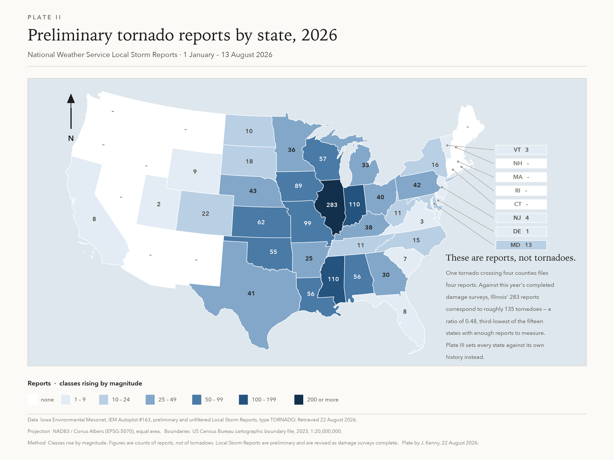

# Illinois' tornado year, 2026

Between 1 January and 13 August 2026 the National Weather Service logged **283 preliminary
tornado reports in Illinois** — 4.13× the state's own average for those dates, and the highest
count in the twenty-three years the reports have been archived.

**→ [Read the plates](https://jvkenny.github.io/IL-tornadoes-2026/)**

[](https://jvkenny.github.io/IL-tornadoes-2026/)

## What the data supports

- Illinois: **283 reports**, **4.13×** its 2004–2025 average, **#1 of 23 years**. Its previous
  year-to-date high was 156 in 2023.
- The anomaly is regional, not national. Indiana 3.54×, Pennsylvania 3.00×, Michigan 2.66× —
  Illinois, Indiana and Pennsylvania each at their own record.
- Classic Tornado Alley sat the year out: Texas **0.38×** (21st of 23 years), Florida 0.23×,
  Tennessee 0.35×.
- Nationally the season is only **1.16×** normal. The country did not have an unusual number of
  tornadoes; a compact band of the Midwest and Ohio Valley had a disproportionate share.

## Reports are not tornadoes

The headline 283 is a count of *reports*. One tornado crossing four counties files four reports.
Where 2026's damage surveys are complete, Illinois has **68 confirmed tornadoes against 143
reports** — a ratio of 0.476, third-lowest of the fifteen states with enough reports to measure
one, and well below Illinois' own historical 0.773. That leaves two defensible translations,
and they disagree:

| Calibration | Ratio | Implied tornadoes |
|---|---|---|
| Illinois' pooled 2004–2025 history | 0.773 | **219** |
| Illinois' own completed 2026 surveys | 0.476 | **135** |
| *Illinois' all-time record, 2024* | — | *133* |

Both are shown rather than averaged. Either way the confirmed count lands at or above the state
record, with three and a half months of the season still to run. See
[`analysis/NOTES.md`](analysis/NOTES.md) for the full verdict and open threads.

## Reproducing

Raw sources are snapshotted in `analysis/data/` and never edited — this matters, because the
preliminary reports are revised continuously (Illinois read 275 on 12 August and 283 ten days
later). `findings.json` is the single source of truth: the plates and the website both read it,
and no derived number is typed by hand into either.

```bash
cd analysis
uv run --with pandas --with numpy   python3 fetch.py && python3 fetch_hist.py  # re-acquire
uv run --with pyshp --with pyproj   python3 geometry.py                        # boundaries
uv run --with pandas --with numpy   python3 analysis.py                        # findings.json
uv run --with matplotlib            python3 plates.py                          # static plates
uv run --with pandas --with pyproj --with matplotlib python3 build_web.py      # web bundle
cd .. && python3 build.py                                                      # index.html
```

## Layout

| Path | |
|---|---|
| `index.html` | the site — self-contained, no external requests |
| `template.html`, `build.py` | source template and the data-injection step |
| `plate_II_*`, `plate_III_*` | print editions, PNG at 300 dpi and vector PDF |
| `analysis/SOURCES.md` | numbered sources, counting rules, and data defects found |
| `analysis/NOTES.md` | verdict, caveats, what I'd fetch next |
| `analysis/findings.json` | every number the plates and the site display |

## Cartographic notes

Maps are **NAD83 / Conus Albers (EPSG:5070)** — equal area, which comparing a quantity between
states requires. Plate II is a raw-count choropleth, reproduced faithfully because it is the map
that prompted this; Plate III is the corrected version, with every state set against its own
average and diverging about a true midpoint of 1.0×. States averaging under five reports a year
are masked, because a ratio on that base rate is noise. Every label/fill pair on both plates
clears WCAG 4.5:1, and classes remain separable in greyscale.

## Two data defects worth knowing

- **The SPC file carries a corrupt state FIPS** — at least one Idaho record coded `19`, which is
  Iowa's. Deriving a FIPS→state map from that column silently moves all 39 of Iowa's 2026
  confirmed tornadoes to Idaho. This repo maps by Census state name instead.
- **2003 is unavailable** from IEM Autoplot #163 (HTTP 400), so the report baseline is 23 years.

## Sources and licence

Data from the [Iowa Environmental Mesonet](https://mesonet.agron.iastate.edu/), the
[NOAA Storm Prediction Center](https://www.spc.noaa.gov/wcm/), [NOAA NCEI Storm
Events](https://www.ncei.noaa.gov/), and the US Census Bureau — all works of the US Government
and in the public domain. Full provenance with retrieval dates in
[`analysis/SOURCES.md`](analysis/SOURCES.md).

Code and prose in this repository are MIT licensed. Preliminary storm reports are preliminary:
counts are revised as damage surveys complete.
